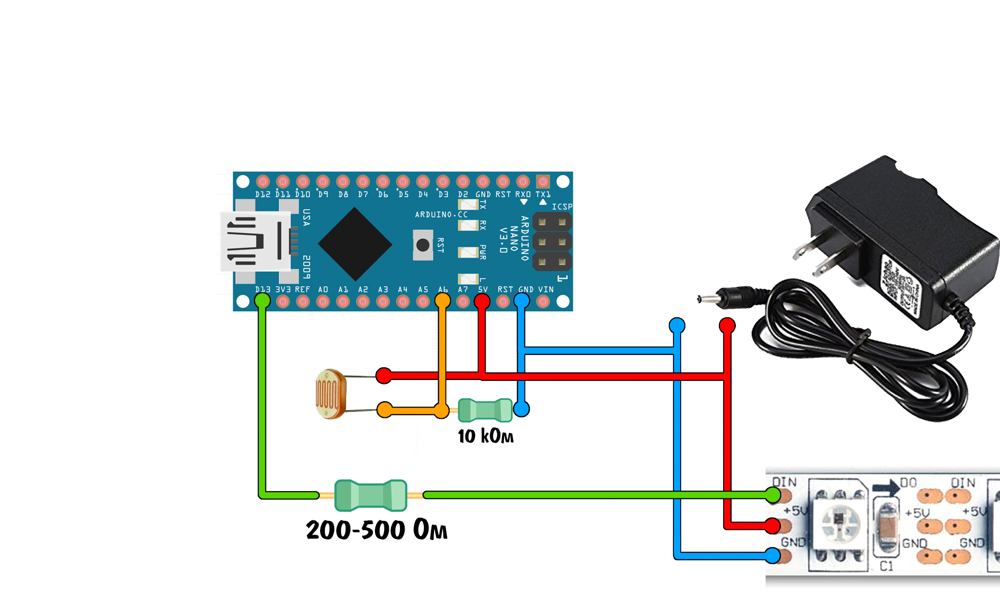

# girland — гирлянда на WS2812B

Прошивка для Arduino Nano (ATmega328P, 16 МГц) и адресной ленты WS2812B.
Сейчас в `girland.ino` стоит `LED_COUNT 160`, но код масштабируется и на
много больше светодиодов — вплоть до ~1500 при минимальной глубине цвета
(см. раздел «Схема»). Внутри — 80 эффектов, адаптивная яркость по
фотосенсору, симметричная раскладка для окна/арки и отладочный лог по UART.

## Возможности

- 80 эффектов, случайная смена с плавными переходами.
- 10 светодиодов в конце ленты выделены под «звезду» (`LED_STAR_LENGTH`,
  начало рассчитывается автоматически: `LED_COUNT - LED_STAR_LENGTH`).
- Адаптивная яркость: фотосенсор на аналоговом входе, диапазон
  `MIN_BRIGHT..MAX_BRIGHT`.
- Симметричные эффекты умеют рисовать одну сторону и зеркалить её на 2–4
  сегмента (`SYM_SEG_CNT`, `SYM_SEG_DIR`).
- По UART на скорости 115200 при старте каждого эффекта отправляется строка
  `E:NN\r\n` (NN = 00..79).
- Сторожевой таймер (WDT) на 4 секунды.
- Сборка проверяется в CI (см. `.github/workflows/build.yml`).

## Железо и подключение

| Что | Куда |
| --- | --- |
| DIN ленты | `D13` (`LED_DT`) |
| Питание ленты | внешний БП 5 В |
| Земля | общая с Arduino (GND) |
| Фотосенсор, сигнал | `A2` (`PHOTO_SENSOR`) |
| Фотосенсор, земля | `A1` (`PHOTO_GND_PIN`, выход LOW) |
| Фотосенсор, питание | `A3` (`PHOTO_VCC_PIN`, выход HIGH) |

### Питание

- **Не питайте ленту от пина 5V Arduino или от USB.** 160 светодиодов даже на
  ограниченной яркости потребляют больше, чем может отдать плата.
- Нужен отдельный блок питания **5 В, не менее 3 А** (лучше 5 А с запасом:
  160 × 60 мА = 9,6 А при полном белом, но прошивка ограничивает яркость
  `MAX_BRIGHT = 100`, поэтому реальный ток заметно ниже).
- Обязательно соедините **GND блока питания и GND Arduino**.
- Между DIN и D13 поставьте резистор **330–470 Ом**, а параллельно питанию
  ленты — электролитический конденсатор **470–1000 мкФ**.
- Если лента и Arduino питаются от одного 5 В, уровень данных совместим. Для
  плат с логикой 3,3 В нужен level shifter.

### Фотосенсор

По умолчанию используется трёхпроводная схема: A1 = GND, A3 = +5 В,
A2 = сигнал (например, фоторезистор в делителе с резистором 10 кОм).

Для двухпинового фоторезистора, вставленного между A1 и A2, включите
`PHOTO_INTERNAL_PULLUP = true`.

Если датчик стоит «наоборот» (светлее = меньше показания), включите
`PHOTO_INVERT = true`.

> Диапазон `MIN_BRIGHT`/`MAX_BRIGHT` и отображение `analogRead()` → яркость
> зависят от конкретного делителя и освещения. Подбирайте значения на месте:
> логика маппинга находится в `check()`.

## Схема



На схеме: DIN ленты через резистор 330–470 Ом (на рисунке подписан
200–500 Ом) подключён к `D13`, лента питается от отдельного блока питания
5 В, земли Arduino и БП соединены.
Фоторезистор включён делителем с резистором 10 кОм: верхнее плечо — питание,
нижнее — земля, средняя точка — сигнал на `A2`. В этой прошивке питание и
землю делителя удобно взять с соседних `A3` (выход HIGH) и `A1` (выход LOW);
если подключаете к обычным +5 В и GND, `A3`/`A1` просто останутся
неподключёнными.

### Сколько светодиодов обслуживает код

Таблица из исходного описания проекта. Строки — `COLOR_DEBTH` (сколько байт
ОЗУ занимает один светодиод), столбцы — объём ОЗУ микроконтроллера,
значения — практическое максимальное число светодиодов с запасом под стек и
локальные массивы эффектов:

| `COLOR_DEBTH` | 1024 Б ОЗУ | 2048 Б ОЗУ |
| --- | --- | --- |
| 1 (8 бит на LED) | 470 | 1250 |
| 2 (16 бит на LED) | 230 | 620 |
| 3 (24 бита на LED, по умолчанию) | 150 | 410 |

Это ориентир, а не жёсткий предел: реальный максимум зависит от версии
скетча, глобальных буферов и глубины стека. При `COLOR_DEBTH 1` и 2 КБ ОЗУ
ленты вплоть до ~1500 светодиодов подключали на практике, но это уже почти
без запаса по RAM. Текущая конфигурация — `LED_COUNT 160`,
`COLOR_DEBTH 3`: буфер ленты занимает 160 × 3 = 480 Б, ещё около 148 Б
занимают остальные статические данные — всего 628 Б. Увеличивать `LED_COUNT`
можно, но после сборки смотрите на размер `.bss` и оставляйте место стеку и
локальным массивам (например, `heat[]` в `Fire()`). Проверка масштабирования
на этой же сборке: `LED_COUNT 1500` при `COLOR_DEBTH 1` даёт
`.data 26 + .bss 1602 = 1628 Б` RAM (свободно ~420 Б) — это верхний
практический предел.

Ограничение в таблице — только по ОЗУ. По питанию 1500 светодиодов при
полном белом — это десятки ампер, поэтому такую ленту всё равно делят на
сегменты и запитывают от нескольких блоков питания.

## Настройки в начале `girland.ino`

| Константа | Значение по умолчанию | Смысл |
| --- | --- | --- |
| `LED_COUNT` | `160` | число светодиодов |
| `LED_DT` | `13` | пин данных |
| `LED_STAR_LENGTH` | `10` | длина «звезды» (0 или закомментировать, если нет) |
| `LED_STAR_START` | авто (`150`) | начало «звезды» (`LED_COUNT - LED_STAR_LENGTH`) |
| `SYM_SEG_CNT` | `2` | число сегментов симметрии |
| `SYM_SEG_DIR` | `1` | направление чередования сегментов |
| `PHOTO_GND_PIN` / `PHOTO_SENSOR` / `PHOTO_VCC_PIN` | `A1` / `A2` / `A3` | пины датчика |
| `PHOTO_INTERNAL_PULLUP` | `false` | подтяжка для 2-пинового датчика |
| `PHOTO_INVERT` | `false` | инверсия датчика |
| `MIN_BRIGHT` | `5` | яркость в темноте |
| `MAX_BRIGHT` | `100` | максимальная яркость |
| `ADAPT_LIGHT` | включено | адаптивная яркость |

`OPT_*` в коде — это общие соглашения о битах переменной `opt`. Каждый эффект
трактует их по-своему; глобальные `mmode`/`dir` используют только
`shift_stream` и `colorWipe`.

## Сборка

### Arduino IDE

1. Установите пакет **Arduino AVR Boards**.
2. Откройте `girland.ino`.
3. Плата: **Arduino Nano**, процессор: **ATmega328P**.
4. Для загрузки на старый Nano может понадобиться
   **ATmega328P (Old Bootloader)** — это влияет только на скорость загрузки,
   не на размер прошивки.

### arduino-cli

```bash
arduino-cli core install arduino:avr
arduino-cli compile --fqbn arduino:avr:nano --warnings all .
```

### Вариант с `-Wl,--relax` (экономия ~200 байт flash)

```bash
arduino-cli compile --fqbn arduino:avr:nano --warnings all \
  --build-property "compiler.c.elf.extra_flags=-Wl,--relax" .
```

Arduino IDE по умолчанию релаксацию не включает, поэтому считайте это
дополнительным резервом, а не обязательным требованием. Флаг действует на
этапе линковки, отдельная перекомпиляция с `-mrelax` не нужна.

## Память

Arduino IDE и `arduino-cli` для AVR собирают скетч с LTO (`-flto`), поэтому
ниже — размеры реальной стандартной сборки (avr-gcc 7.3, `-Os`, LTO):

| Сборка | Flash | RAM (data+bss) | Свободно под Optiboot | Свободно под старый загрузчик |
| --- | --- | --- | --- | --- |
| стандартная (LTO) | 27 724 Б | 628 Б | 4 532 Б | 2 996 Б |
| с `-Wl,--relax` | 27 522 Б | 628 Б | 4 734 Б | 3 198 Б |

- Лимит приложения с **Optiboot** (512 Б загрузчика): **32 256 Б**.
- Лимит со старым загрузчиком на 2 КБ: **30 720 Б** — стандартная LTO-сборка
  помещается с запасом.
- Без LTO (нестандартная конфигурация) прошивка получается около **32 520 Б**
  и в Optiboot **не помещается**. Не отключайте LTO: Arduino IDE и
  `arduino-cli` используют его по умолчанию.
- RAM: 2048 Б всего; свободные ~1,4 КБ делят стек и локальные массивы эффектов
  (например, `heat[]` в `Fire()`), поэтому запас нельзя считать бесконечным.

## UART-протокол

- 115200 бод, 8N1, только передача (TX = D1).
- При запуске каждого эффекта отправляется `E:NN\r\n`, где `NN` — номер
  эффекта от `00` до `79` (порядок в `EFFECT_LIST_OUTER`/`EFFECT_LIST_INNER`).
- Приём команд не реализован: прошивка ничего не читает из UART.

<details>
<summary>Номера эффектов (E:NN)</summary>

```text
00 rainbow_cycle          20 hydraulic_jump          40 doppler_shift           60 kdv_solitons
01 dendritic_crystal      21 solar_wind              41 prism_diffraction       61 Fire
02 heat_diffusion         22 gravitational_lensing   42 meissner_effect         62 BouncingBalls
03 quantum_collapse       23 flame_ambience          43 quantum_spin_chain      63 fireworks
04 plasma_ball            24 wandering_tongue        44 snake_game              64 comet
05 shift_stream           25 quantum_chaos           45 sinelon                 65 boba1
06 radiation              26 bubble_sort             46 juggle                  66 barcode_scanner
07 optical_tweezers       27 rule30_ca               47 bpm                    67 cylon_bounce
08 colorWipe              28 kaleidoscope            48 lightning              68 wave_synthesis
09 random_fill            29 pacman_run              49 water_ripple           69 gravitational_fall
10 theater_chase          30 pride2015               50 fireflies              70 halloween_eyes
11 pendulum_wave          31 blendwave               51 neon_heartbeat         71 shockwave
12 strobe                 32 twinkle_fox             52 synthwave_grid         72 warp_drive
13 police_flasher         33 seismic_waves           53 geiger_counter         73 newtons_cradle
14 morse_code             34 sonoluminescence        54 pulsar_beacon          74 meteor_rain
15 flicker_lamp           35 magnetic_reconnection   55 beatwave               75 dna_helix
16 sparkles               36 percolation_breakdown   56 holographic_opal        76 supernova
17 resonant_wave          37 serendipitous           57 deep_sea_jellyfish     77 liquid_silk
18 acoustic_resonance     38 block_chase             58 cellular_fire          78 stroboscopic_levitation
19 wandering_lights       39 vu_meter_sim            59 nuclear_fission        79 quantum_tunneling
```

</details>

## Структура проекта

- `girland.ino` — эффекты, диспетчер, переходы, UART, настройки.
- `miniled.h` — `TLED`, `TStrip`, `CHSV` и быстрые операции над цветом.
- `miniled_tools.h` — математика, ГПСЧ, `memset8`.
- `miniled_send.h` — низкоуровневая отправка WS2812B.

## Безопасность

- В эффектах есть стробирование, вспышки и «молнии». **Не смотрите на ленту
  вблизи**, если у вас или у окружающих есть фотосенситивная эпилепсия.
- Не оставляйте самодельную гирлянду без присмотра на долгое время.
- Проверяйте нагрев проводов и блока питания; тонкие провода и плохой контакт
  на 3–5 А — частая причина пожара.
- Прошивка использует WDT, но он не заменяет предохранитель и нормальное
  охлаждение.

## Примечания

- Схема-основа: [AlexGyver/WS2812_FX](https://github.com/AlexGyver/WS2812_FX).
- Часть эффектов и математики — производные от примеров FastLED.
- Если добавляете эффект, добавьте его в `EFFECT_LIST_OUTER` (обычные) или
  `EFFECT_LIST_INNER` (симметричные). `TOTAL_EFFECTS` пересчитается
  автоматически; при сдвиге границы обновите `SYM_EFFECT_START`.
